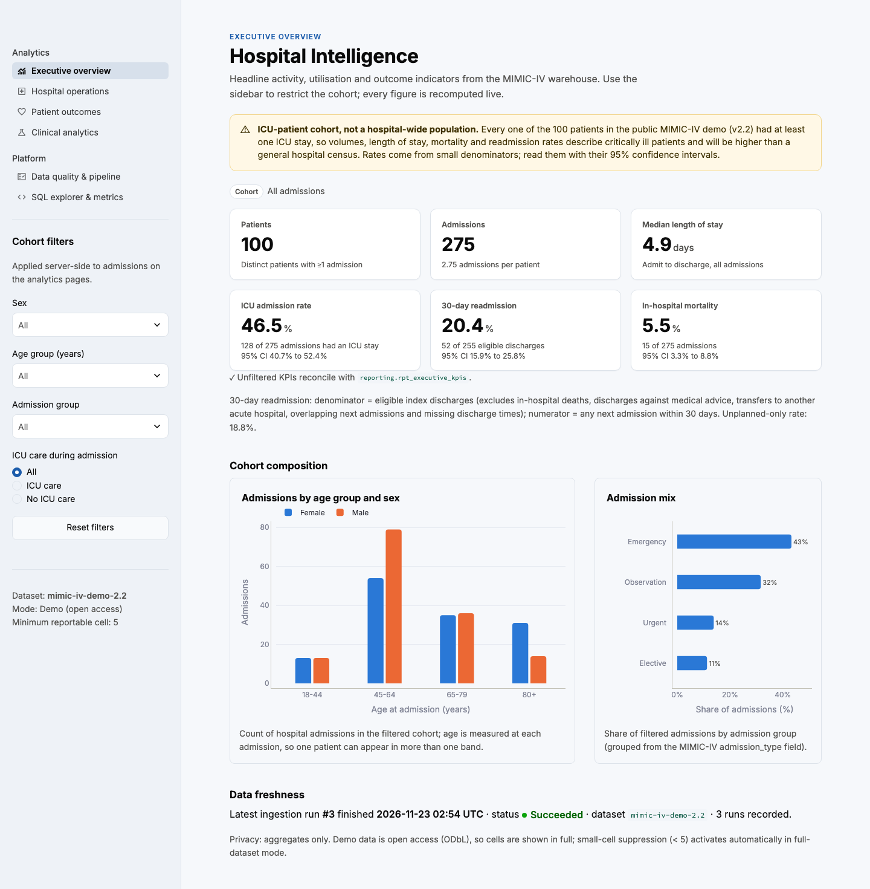
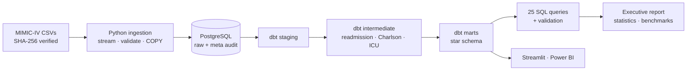
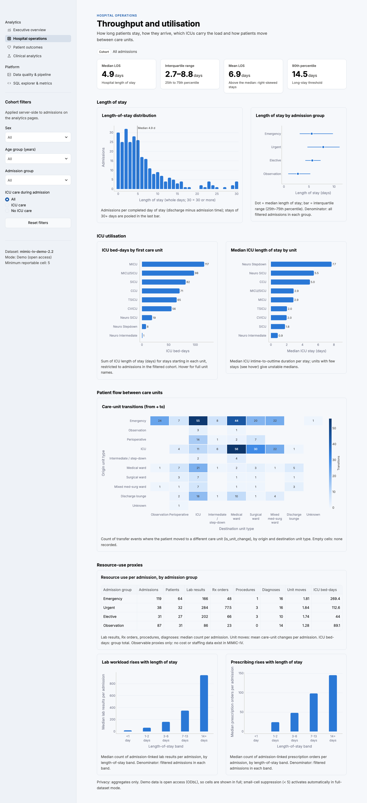
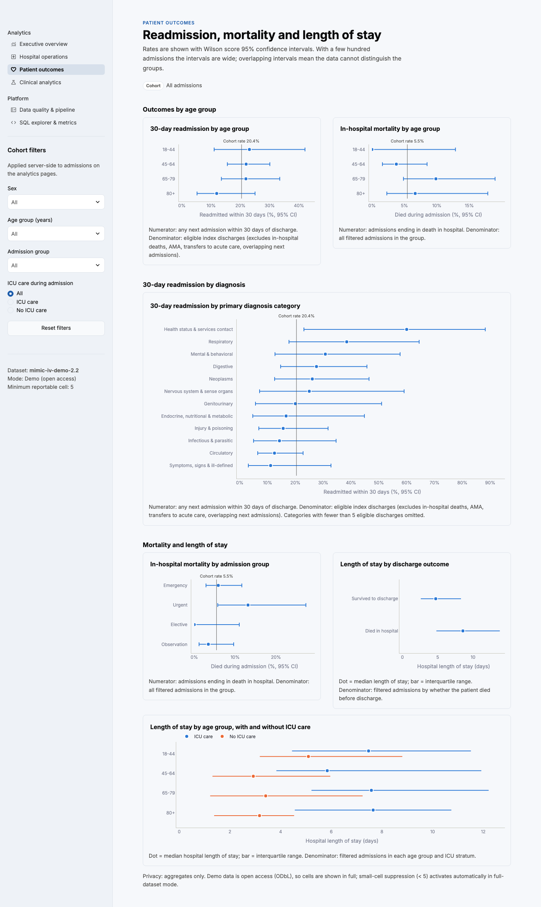
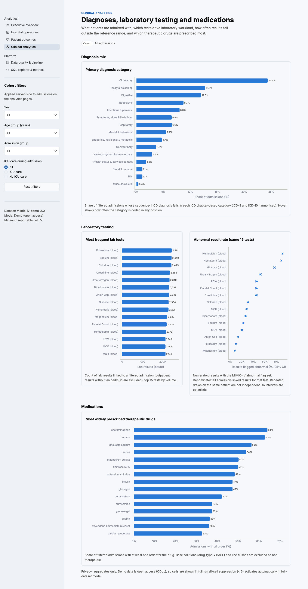
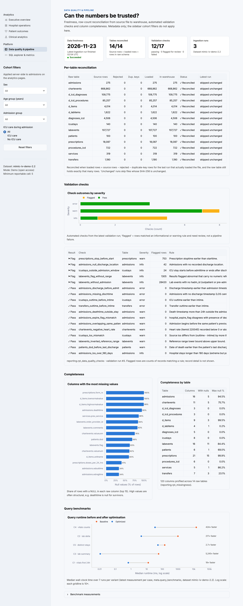

# Hospital Intelligence

**A scalable healthcare analytics and hospital operations intelligence platform built on MIMIC-IV.**

Hospital Intelligence turns raw, de-identified electronic health records into validated
hospital-operations metrics. It covers admissions, length of stay, ICU utilisation, 30-day
readmissions, mortality, lab and medication patterns, and resource-use proxies. A Python
pipeline streams MIMIC-IV into PostgreSQL with type-safe validation. dbt builds a tested star
schema. **25 documented analytical SQL queries** answer operational questions. Every
headline metric is independently re-derived to prove it is correct, and the results feed a
Streamlit dashboard, a Power BI package and an executive report.

> **Data scope, stated up front.** Everything here runs on the public
> [MIMIC-IV Clinical Database Demo v2.2](https://physionet.org/content/mimic-iv-demo/2.2/):
> 100 patients and 275 admissions, all of whom had at least one ICU stay. All results are
> real outputs of this code on that sample. They describe an ICU-patient cohort, not a
> hospital, and they are exploratory. The full credentialed MIMIC-IV v3.1 has not been run;
> the pipeline is built to scale to it ([limitations](docs/limitations.md)).



---

## What This Project Demonstrates

| Skill | Where to look |
|---|---|
| **Advanced SQL** | [25 queries](docs/sql_catalog.md) using CTEs, `LEAD`/`LAG`, `ROW_NUMBER`/`RANK`/`DENSE_RANK`, `ROLLUP`/`GROUPING SETS`, `FILTER`, `percentile_cont`, running windows, self-joins with lift, and Wilson CIs computed in SQL |
| **Healthcare analytics** | Explicit 30-day readmission methodology with exclusions; Charlson comorbidity (Quan 2005, ICD-9 and ICD-10); harmonised ICD chapters; ICU mortality attribution; utilisation vs occupancy |
| **Data cleaning and quality** | Type-safe ingestion with quarantined rejects; reconciliation; duplicate and orphan detection; 17 plausibility checks (flagged, never deleted) |
| **Data warehousing** | dbt staging → intermediate → star schema (7 facts, 6 dims), declared grains, incremental lab fact, 103 data tests + 2 unit tests |
| **Analytical rigour** | Every headline metric re-derived independently (SQL `NOT EXISTS` and pandas on the raw CSVs); patient-cluster bootstrap; effect sizes before p-values; sensitivity analysis |
| **Performance optimisation** | 5 `EXPLAIN ANALYZE` case studies, results verified identical, with setup costs reported |
| **Business intelligence** | Streamlit + Plotly app (6 pages, live filters, small-cell suppression); Power BI star-schema export, 105 DAX measures, M scripts, page specs |
| **Reproducibility** | One command rebuilds everything from the public download: `scripts/run_pipeline.sh` (about 3 minutes) |

## Business problem

Operations leaders ask simple questions that are hard to answer reliably from EHR data:
*How long do patients stay? Who comes back within 30 days? Where does ICU capacity go?
Which patients drive utilisation?* The raw data mixes ICD-9 and ICD-10, shifts dates,
records labs with no admission attached and contains real clinical extremes. A wrong join or
an undefined denominator produces confident, wrong KPIs. This project shows the full path
from raw records to defensible numbers.

## Architecture



Details, design decisions and the ER diagram: [docs/architecture.md](docs/architecture.md).

**Stack:** Python 3.12 · PostgreSQL 16 · dbt Core 1.10 · pandas · Polars · PyArrow · DuckDB (profiling) · SQLAlchemy/psycopg 3 · SciPy · Streamlit · Plotly · matplotlib · pytest · ruff · Docker Compose · GitHub Actions · Power BI (package).

## Data warehouse

| Fact | Grain | Rows (demo) |
|---|---|---:|
| `fact_admissions` | hospital admission (`hadm_id`) | 275 |
| `fact_readmissions` | admission as a potential index discharge | 275 |
| `fact_icu_stays` | ICU stay (`stay_id`) | 140 |
| `fact_care_transfers` | admission-linked movement into a care unit | 861 |
| `fact_diagnoses` | billed diagnosis (`hadm_id`, `seq_num`) | 4,506 |
| `fact_lab_events` | lab measurement (`labevent_id`, incremental) | 107,727 |
| `fact_medication_orders` | prescription order | 18,087 |

Dimensions: patient, admission type, care unit, diagnosis (ICD-9 + ICD-10), lab test,
medication. Child tables are aggregated to `hadm_id` before every join; tests and a
reconciliation query prove no join inflates counts. Full column list:
[data dictionary](docs/data_dictionary.md).

## SQL analytics example

30-day readmission. The denominator excludes deaths, transfers to another acute hospital,
against-advice discharges and overlapping stays
([full definition](docs/metric_definitions.md#30-day-readmission)):

```sql
-- int_readmission_pairs.sql (excerpt): pair each admission with the patient's next one
select hadm_id, dischtime, discharge_location, died_in_hospital,
       lead(hadm_id)        over w as next_hadm_id,
       lead(admittime)      over w as next_admittime,
       lead(is_planned)     over w as next_is_planned
from admissions
window w as (partition by subject_id order by admittime, hadm_id)
```

Result: **52 of 255 eligible discharges (20.4%, 95% CI 15.9–25.8%)**. The same figure comes
out of a `NOT EXISTS` self-join on the raw tables and a pandas implementation reading the
original CSVs. A dbt unit test covers 16 synthetic edge cases (8-hour return, exact 30-day
boundary, overlap, death, missing discharge, planned return, AMA).

All 25 queries, with business question, grain, joins, denominator, biases, actual output and
interpretation: **[docs/sql_catalog.md](docs/sql_catalog.md)**.

## Dashboards

| Streamlit (runnable) | |
|---|---|
|  |  |
|  |  |

```bash
.venv/bin/python -m streamlit run dashboard/streamlit/app.py
```

The app has six pages (overview, operations, outcomes, clinical, data quality and pipeline,
SQL explorer), server-side parameterised filters, aggregate-only output and automatic
small-cell suppression in full-dataset mode.

**Power BI:** [`powerbi/`](powerbi/README.md) contains a star-schema export (CSV + Parquet),
105 DAX measures, Power Query M, a theme, a five-page layout spec and a build guide with a
validation checklist. **No `.pbix` is included:** Power BI Desktop was not available in the
build environment, and the DAX/M have not been executed in Power BI.

## Major findings (exploratory, demo cohort)

Full write-up with charts and uncertainty: **[reports/executive_report.md](reports/executive_report.md)**.

1. **Use is concentrated.** 12 patients with 7+ admissions generate 43.6% of all admissions
   and average 2.58 30-day readmissions each (Q10).
2. **The readmission KPI depends on its definition.** 20.4% primary, 23.7% excluding
   observation stays, 15.8% with one discharge per patient
   ([statistics report](reports/statistics_report.md)).
3. **Long stays cluster by admission type.** URGENT admissions have a median of 7.86 days
   (1.62× the hospital median). "Observation" encounters have a median of 4.85 days, and
   15.6% run past 14 days (Q21).
4. **A minority of ICU stays consume most ICU days.** Stays of 7+ days are 14.3% of stays
   and 45.5% of ICU days (Q12).
5. **Comorbidity tracks resource use.** Admissions with Charlson ≥5 use 1.39× average LOS
   and 1.53× lab volume (Q25). These are event counts, not costs.

## Data quality and testing

| Layer | What is checked | Result |
|---|---|---|
| Ingestion | type parsing, NOT NULL, length/range; reconciliation; duplicate keys; orphans; 17 plausibility checks | 14 tables, 1.0M rows, 0 rejects, 0 duplicates, 0 orphans; 5 informational flags ([report](reports/ingestion/ingestion_report.md)) |
| dbt | 103 data tests + 2 unit tests (readmission edge cases, Charlson hierarchy) | 143/143 nodes pass |
| Independent validation | 17 metric components re-derived from raw tables | all exact matches |
| pytest | unit (parser, contract, statistics vs published values), integration (queries, validation, pandas re-implementation, privacy, dashboard, Power BI export) | **133 passed** |

## Query performance benchmarks

Measured on demo data (PostgreSQL 16, Apple Silicon; median of 7 runs; results verified
identical). These are demo-scale, not full-data projections. Latest run:
[benchmark report](reports/benchmarks/benchmark_report.md).

| Case | Optimisation | Baseline | Optimised |
|---|---|---:|---:|
| Vital-sign counts per ICU stay | 5 correlated scans → 1 pass with `FILTER` | ~13.2 s | ~32 ms |
| Lab delta check | correlated subquery → `LAG()` | ~1.05 s | ~4.5 ms |
| First-24h heart rate per stay | covering composite index (254 ms build) | ~11 ms | ~0.7 ms |
| Lab summary for dashboards | materialized view (63 ms build) | ~57 ms | ~0.01 ms |
| Distinct stays per item | `COUNT(DISTINCT)` → two-phase `GROUP BY` | ~119 ms | ~49 ms |

## Setup and reproduction

**Prerequisites:** Python 3.11+ and PostgreSQL 16 (local install or Docker).

```bash
git clone <repo> hospital-intelligence && cd hospital-intelligence
scripts/setup_local.sh --with-postgres   # venv + deps; local PG on :5433 (needs initdb on PATH)
# or: docker compose up -d db            # PostgreSQL in Docker (see note below)
scripts/run_pipeline.sh                  # download → ingest → dbt → queries → stats → benchmarks → reports → tests
```

Individual steps:

```bash
python -m ingestion.download_demo                    # public demo, checksum-verified
python -m ingestion.pipelines.run_ingestion          # raw load + audit (restartable)
cd dbt_project && dbt build --profiles-dir . && cd ..
python -m analytics.reporting.sql_catalog            # runs the 25 queries → docs/sql_catalog.md
python -m analytics.statistics.run_statistics
python -m analytics.performance.benchmark
python -m analytics.reporting.executive_report
pytest -q
```

**Full dataset:** obtain credentialed PhysioNet access ([data/README.md](data/README.md)),
place the files under `data/full/mimiciv/3.1/`, set `HI_DATASET_MODE=full`. Ingestion streams
in batches; patient-level outputs are git-ignored.

> **Verification status.** The local workflow above was executed end to end on macOS
> (PostgreSQL 16.16, Python 3.12). `docker-compose.yml`, the `Dockerfile` and the GitHub
> Actions workflow are written and syntax-checked but **were not executed** (Docker and a
> remote repository were unavailable). See [PROGRESS.md](PROGRESS.md).

## Repository layout

```
config/          source contract (sources.yaml) and settings
ingestion/       downloader, streaming loader, validators, pipeline
database/        schema DDL (meta, generated raw), indexes
dbt_project/     staging · intermediate · marts · reporting, seeds, macros, tests
sql/             25 analytical queries by module, validation, optimization cases
analytics/       statistics, reporting (catalog, executive report, dictionary), benchmarks
dashboard/       Streamlit app
powerbi/         export script, DAX, Power Query, specs, guide
tests/           pytest suite
docs/            architecture, metrics, catalog, dictionary, limitations, demo script, interview prep
reports/         generated reports and figures (aggregate only)
```

## Limitations

The demo is a 100-patient ICU cohort. The data comes from a single centre with shifted dates
and contains no cost, staffing or bed-capacity data. Readmission sees only same-hospital
returns and has no censoring. No severity adjustment is applied. Diagnoses come from billing
codes. Full list: [docs/limitations.md](docs/limitations.md).

## Future improvements

- Run and benchmark on credentialed MIMIC-IV v3.1; partition `chartevents`.
- Severity adjustment (for example SOFA from `chartevents`) for mortality comparisons.
- CCSR diagnosis grouping for ICD-10; RxNorm mapping for drugs; eMAR for administrations.
- Validated planned-readmission logic (CMS algorithm with procedure codes).
- Validate the BigQuery backend ([docs/bigquery.md](docs/bigquery.md)); execute CI and Docker.

## Data use

MIMIC-IV demo: Open Database License (ODbL). Full MIMIC-IV: PhysioNet Credentialed Health
Data Use Agreement, so **never commit or share patient-level data**. `tests/test_privacy.py`
enforces the ignore rules.

Johnson, A., Bulgarelli, L., Pollard, T., Horng, S., Celi, L. A., & Mark, R. MIMIC-IV
(version 3.1). PhysioNet. Johnson, A. et al. MIMIC-IV Clinical Database Demo (version 2.2).
PhysioNet. https://doi.org/10.13026/dp1f-ex47
