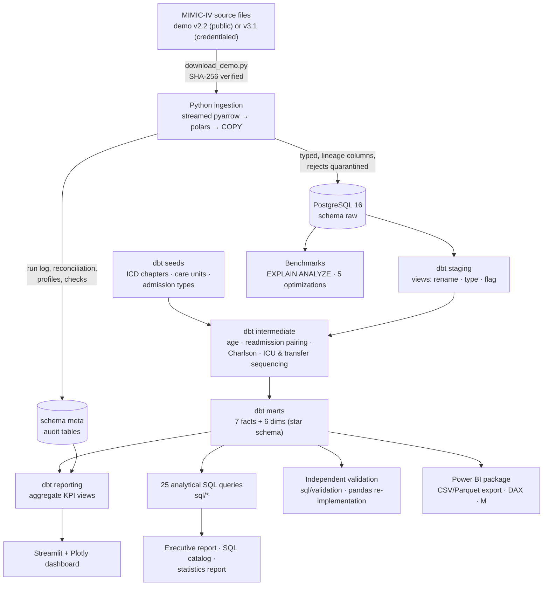
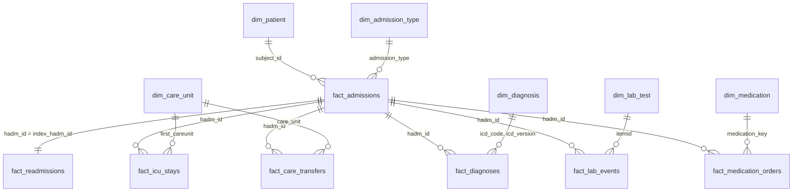

# Architecture

## Data flow

## Layers and responsibilities

| Layer | Where | Materialization | Responsibility | Never does |
|---|---|---|---|---|
| Ingestion | `ingestion/` | `raw.*` tables | Type-safe parsing, reject capture, reconciliation, duplicate/orphan measurement, plausibility flags, indexes | Drop or "fix" outliers, apply business rules |
| Staging | `dbt_project/models/staging` | views | Rename, light typing, derive flags (abnormal, race group, LOS hours) | Join tables |
| Intermediate | `.../intermediate` | tables | Business logic: age derivation, readmission pairing, ICD categorisation, Charlson, ICU/transfer sequencing | Present data to BI |
| Marts | `.../marts/core` | tables (lab facts incremental) | Star schema with one declared grain per table | Mix grains |
| Reporting | `.../marts/reporting` | views | Aggregate-only KPIs and pipeline status for dashboards | Expose patient-level rows |

## Dimensional model

| Fact | Grain | Rows (demo) |
|---|---|---:|
| fact_admissions | one hospital admission (hadm_id) | 275 |
| fact_readmissions | one admission as a potential index discharge | 275 |
| fact_icu_stays | one ICU stay (stay_id) | 140 |
| fact_care_transfers | one admission-linked movement into a care unit | 861 |
| fact_diagnoses | one billed diagnosis (hadm_id, seq_num) | 4,506 |
| fact_lab_events | one lab measurement (labevent_id) | 107,727 |
| fact_medication_orders | one prescription order | 18,087 |

**Fan-out prevention.** `fact_admissions` carries per-admission counts (labs, ICU stays,
diagnoses, …). Each child table is aggregated to `hadm_id` in its own CTE before the
join. Three controls enforce this: `row_count_equals` dbt tests (fact rows = source rows),
`unique` tests on every grain key, and `sql/validation/v03_fanout_reconciliation.sql`,
which checks that summed per-admission counts equal raw event counts.

## Design decisions

| Decision | Choice | Why |
|---|---|---|
| Local database | PostgreSQL 16 | Window functions, ordered-set aggregates, `FILTER`, `EXPLAIN ANALYZE`; free; matches the official MIMIC build scripts |
| Ingestion engine | pyarrow streaming CSV reader → polars → `COPY` | Bounded memory for multi-GB gz files; `COPY` is the fastest PostgreSQL bulk path; polars gives vectorised, strict-vs-lenient parsing for reject capture |
| Restartability | per-table transaction + file SHA-256 + contract hash | Unchanged tables are skipped; a failed table rolls back and leaves the previous good load in place |
| Keys | MIMIC source identifiers (subject_id, hadm_id, stay_id, labevent_id) | Stable, already unique (tested); surrogate hash key only where the source has none (prescriptions) |
| ICD grouping | Harmonised chapter seed covering ICD-9 and ICD-10 | The demo has about 50/50 ICD-9/ICD-10 codes; chapter-level is the coarsest grouping valid across both |
| Comorbidity | Charlson (Quan 2005 coding) | Validated, version-aware, widely used in MIMIC research (adapted from mimic-code) |
| Cross-database SQL | dispatch macros (`hours_between`, `add_hours`) | Core date logic compiles for PostgreSQL and BigQuery |
| Large-fact strategy | `fact_lab_events` incremental (delete+insert on labevent_id) with indexes | Full labevents is more than 150M rows; avoids rebuilding it on every run |

## Scaling to the full dataset

| Concern | Mechanism already in place | Still to validate on full data |
|---|---|---|
| Memory | Streaming reader, `HI_BATCH_ROWS` batches | Peak RSS while loading labevents/chartevents |
| Load time | `COPY`, indexes built after load, restart skip | Wall-clock hours for chartevents (hundreds of millions of rows) |
| Profiling cost | 1% `TABLESAMPLE` for large tables in full mode | Sample representativeness |
| Transform cost | Incremental lab fact, pre-aggregated marts | dbt run time; whether `fact_care_transfers` needs incremental |
| Query cost | Benchmarked optimizations (covering indexes, window rewrites, MVs) | Plans at full scale; partitioning chartevents by stay or time |
| Alternative | BigQuery profile + dispatch macros | Not executed; see [bigquery.md](bigquery.md) |
