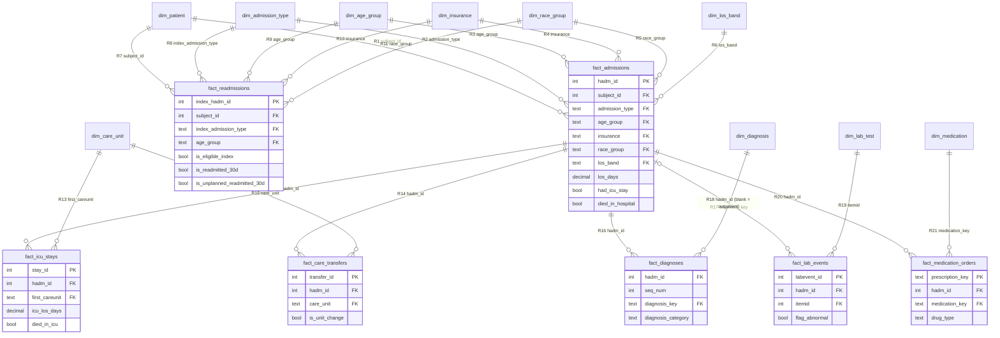

# Power BI data model: Dashboard A

This page describes the semantic model the report is built on: which tables it holds, the grain and keys of each, how they relate, and the rules that keep filters from double-counting. Every table maps one-to-one to a file written by `powerbi/export_powerbi_datasets.py`, or to a query in `power_query.m` when you load directly from PostgreSQL.

Row counts below come from the export run on 2026-11-22 against `mimic-iv-demo-2.2`. The live numbers are in `powerbi/datasets/manifest.json`.

## Design in one paragraph

`fact_admissions` (one row per hospital admission) is the hub. It filters the four child facts (ICU stays, care transfers, diagnoses, lab events and medication orders) through `hadm_id`, with single-direction, many-to-one relationships. Patient attributes come from `dim_patient`. Admission-level attributes used as slicers (age group, insurance, race group, admission group) sit in small conformed dimensions. Those dimensions filter `fact_admissions` and `fact_readmissions` directly, so one slicer drives both the admission-based and the readmission-based measures. `fact_readmissions` is **not** related to `fact_admissions`. It carries its own denormalised index-admission attributes, which avoids an ambiguous second path from the dimensions. The reporting and audit tables have no relationships.

## Tables

### Facts

| Table | Grain (primary key) | Rows | Notes |
|---|---|---:|---|
| `fact_admissions` | one row per hospital admission (`hadm_id`) | 275 | Hub fact. It also serves as the "admission" dimension for the child facts. It holds pre-aggregated child counts (`n_lab_events`, `n_icu_stays`, ...) with no fan-out. |
| `fact_readmissions` | one row per potential index admission (`index_hadm_id`) | 275 | Rate denominator = rows where `is_eligible_index` (255). Attributes describe the index admission. |
| `fact_icu_stays` | one ICU stay (`stay_id`) | 140 | `first_careunit` links to `dim_care_unit`. |
| `fact_care_transfers` | one care-unit movement (`transfer_id`) | 861 | `care_unit` links to `dim_care_unit`. |
| `fact_diagnoses` | one billed diagnosis (`hadm_id`, `seq_num`) | 4,506 | The export adds `diagnosis_key` = `icd_version` + `-` + `icd_code` (for example `10-I10`) so the relationship to `dim_diagnosis` uses one column. |
| `fact_lab_events` | one lab measurement (`labevent_id`) | 107,727 | `hadm_id` is blank for 28,420 outpatient labs (`is_admission_linked = false`). |
| `fact_medication_orders` | one prescription order (`prescription_key`) | 18,087 | Orders, not administrations. Therapeutic measures exclude `drug_type = "BASE"` and flushes. |

### Dimensions

| Table | Grain (key) | Rows | Notes |
|---|---|---:|---|
| `dim_patient` | patient (`subject_id`) | 100 | sex, anchor age, `anchor_year_group`, admission-frequency band. |
| `dim_admission_type` | `admission_type` | 9 | Maps the source type to `admission_group` (Emergency, Urgent, Elective, Observation). |
| `dim_care_unit` | `care_unit` | 42 | `unit_type`, `is_icu`. |
| `dim_diagnosis` | `diagnosis_key` | 1,474 | Filtered to the codes used in `fact_diagnoses`. The warehouse dictionary has 109,775 rows, and `--full-diagnosis-dictionary` exports all of them. |
| `dim_lab_test` | `itemid` | 1,622 | test name, fluid, category. |
| `dim_medication` | `medication_key` | 598 | normalised drug name, most common route. |
| `dim_age_group` | `age_group` | 4 | Derived. Set **Sort by column** to `age_group_order`. |
| `dim_insurance` | `insurance` | 3 | Derived. |
| `dim_race_group` | `race_group` | 5 | Derived. |
| `dim_los_band` | `los_band` | 5 | Derived. Set **Sort by column** to `los_band_order`. |

The derived tables are the distinct values of the matching column in `fact_admissions` and `fact_readmissions`. They exist only so one slicer can filter both facts.

### Disconnected tables (no relationships)

| Table | Grain | Used on |
|---|---|---|
| `rpt_executive_kpis` | one row | Page 5 reconciliation card (SQL value next to DAX value) |
| `rpt_pipeline_status` | one row per source table | Page 5 pipeline table and freshness |
| `rpt_data_quality_checks` | one row per validation check (latest run) | Page 5 |
| `rpt_missingness` | one row per profiled source column | Page 5 |
| `query_benchmarks` | one row per benchmark measurement | Page 5 (may be empty) |
| `ingestion_runs` | one row per ingestion run | Page 5 freshness |
| `_Measures` | empty | Holds all DAX measures |

## Relationships

All relationships are many-to-one (`*:1`) with a **single** cross-filter direction (from the one side to the many side) unless stated otherwise. When you finish, open Model view and confirm that Power BI has not auto-detected anything else. Turn off **File > Options > Current file > Data load > Autodetect new relationships after data is loaded** before the first load.

| # | From (many) | To (one) | Cardinality | Cross-filter | Active |
|---|---|---|---|---|---|
| R1 | `fact_admissions[subject_id]` | `dim_patient[subject_id]` | *:1 | Single | Yes |
| R2 | `fact_admissions[admission_type]` | `dim_admission_type[admission_type]` | *:1 | Single | Yes |
| R3 | `fact_admissions[age_group]` | `dim_age_group[age_group]` | *:1 | Single | Yes |
| R4 | `fact_admissions[insurance]` | `dim_insurance[insurance]` | *:1 | Single | Yes |
| R5 | `fact_admissions[race_group]` | `dim_race_group[race_group]` | *:1 | Single | Yes |
| R6 | `fact_admissions[los_band]` | `dim_los_band[los_band]` | *:1 | Single | Yes |
| R7 | `fact_readmissions[subject_id]` | `dim_patient[subject_id]` | *:1 | Single | Yes |
| R8 | `fact_readmissions[index_admission_type]` | `dim_admission_type[admission_type]` | *:1 | Single | Yes |
| R9 | `fact_readmissions[age_group]` | `dim_age_group[age_group]` | *:1 | Single | Yes |
| R10 | `fact_readmissions[insurance]` | `dim_insurance[insurance]` | *:1 | Single | Yes |
| R11 | `fact_readmissions[race_group]` | `dim_race_group[race_group]` | *:1 | Single | Yes |
| R12 | `fact_icu_stays[hadm_id]` | `fact_admissions[hadm_id]` | *:1 | Single | Yes |
| R13 | `fact_icu_stays[first_careunit]` | `dim_care_unit[care_unit]` | *:1 | Single | Yes |
| R14 | `fact_care_transfers[hadm_id]` | `fact_admissions[hadm_id]` | *:1 | Single | Yes |
| R15 | `fact_care_transfers[care_unit]` | `dim_care_unit[care_unit]` | *:1 | Single | Yes |
| R16 | `fact_diagnoses[hadm_id]` | `fact_admissions[hadm_id]` | *:1 | Single | Yes |
| R17 | `fact_diagnoses[diagnosis_key]` | `dim_diagnosis[diagnosis_key]` | *:1 | Single | Yes |
| R18 | `fact_lab_events[hadm_id]` | `fact_admissions[hadm_id]` | *:1 | Single | Yes |
| R19 | `fact_lab_events[itemid]` | `dim_lab_test[itemid]` | *:1 | Single | Yes |
| R20 | `fact_medication_orders[hadm_id]` | `fact_admissions[hadm_id]` | *:1 | Single | Yes |
| R21 | `fact_medication_orders[medication_key]` | `dim_medication[medication_key]` | *:1 | Single | Yes |

There are **no inactive relationships** in this model, and none are needed: no measure uses `USERELATIONSHIP`. The test `tests/test_powerbi_export.py::test_relationship_keys_are_unique_and_complete` checks every relationship above against the exported files. It confirms that each one-side key is unique and non-blank, and that no many-side value is orphaned (blank `hadm_id` in `fact_lab_events` is allowed).

### Relationships you must NOT create

| Do not create | Why |
|---|---|
| `fact_readmissions[index_hadm_id]` to `fact_admissions[hadm_id]` | Both columns are unique, so Power BI would make it one-to-one, and one-to-one relationships always filter in both directions. It would also give `dim_age_group` and the other dimensions two paths to `fact_readmissions` (direct, and through `fact_admissions`), which is ambiguous. If a visual really needs it, use `TREATAS` inside a measure instead. |
| `fact_readmissions[next_hadm_id]` to `fact_admissions[hadm_id]` | Same problem. |
| `fact_icu_stays[subject_id]`, `fact_care_transfers[subject_id]`, `fact_diagnoses[subject_id]`, `fact_lab_events[subject_id]`, `fact_medication_orders[subject_id]` to `dim_patient` | `dim_patient` already reaches these facts through `fact_admissions`. A second direct path is ambiguous, and Power BI would silently make one of them inactive. Hide these columns. |
| `fact_icu_stays[age_group]`, `[sex]`, `[admission_group]` to any dimension | These are snapshot copies. Filter ICU stays through `fact_admissions`. Hide these columns. |
| Any relationship between facts set to **Both** | Bidirectional filters between facts make totals depend on which visual filters which, and they fan out. For example, filtering diagnoses would filter admissions, which would then filter labs. |
| Relationships to the `rpt_*`, `query_benchmarks` or `ingestion_runs` tables | These have a different grain (run, check or table). Use them as standalone tables on page 5. |
| A date table marked as a date table and joined to `admittime` | MIMIC shifts dates per patient into the years 2110 to 2201. Calendar trends across patients mean nothing. `dim_patient[anchor_year_group]` is the only valid period proxy. |

## ER diagram

The disconnected tables (`rpt_*`, `query_benchmarks`, `ingestion_runs`, `_Measures`) are left out of the diagram.

## How filters flow, and what to watch for

| Slicer or axis on | Filters | Does not filter |
|---|---|---|
| `dim_patient`, `dim_age_group`, `dim_insurance`, `dim_race_group`, `dim_admission_type`, `dim_los_band` | `fact_admissions`, then every child fact; `fact_readmissions` directly (except `dim_los_band`) | the disconnected tables |
| `dim_care_unit` | `fact_icu_stays`, `fact_care_transfers` | `fact_admissions` (so `[Total Admissions]` and `[Total Patients]` ignore it; use `[ICU Stays]` and `[ICU Patients]`) |
| `dim_diagnosis`, `fact_diagnoses[diagnosis_category]` | `fact_diagnoses` | `fact_admissions`. To show mortality by diagnosis, use `fact_admissions[primary_diagnosis_category]`, one per admission, which cannot fan out. |
| `dim_lab_test` | `fact_lab_events` | `fact_admissions` |
| `dim_medication` | `fact_medication_orders` | `fact_admissions` |
| `fact_admissions` columns (for example `admission_group`, `primary_diagnosis_category`) | `fact_admissions`, then the child facts | `fact_readmissions`. For readmission visuals, use the `dim_*` slicer or a `fact_readmissions` column such as `index_primary_diagnosis_category`. |

**Fan-out.** Measures count rows only at their own grain: admissions in `fact_admissions`, stays in `fact_icu_stays`, and so on. Never sum a `fact_admissions` column inside a visual that is grouped by a child-fact attribute expecting per-row repetition. Single-direction filters already prevent this. Do not "fix" a blank by switching a relationship to **Both**.

**Outpatient labs.** Lab rows with a blank `hadm_id` belong to the blank member of `fact_admissions`. They count in `[Lab Events]` only when no admission or patient filter is active. Any slicer on a patient or admission attribute removes them. Use `[Admission-Linked Lab Events]` and `[Labs per Admission]` for consistent per-admission work.

**Readmission denominator.** `[Readmission 30d %]` divides by `[Eligible Index Admissions]`, which is 255, not by all 275 admissions. Never build a readmission rate as a share of `fact_admissions` rows.

**Cohort caveat.** Every patient in the MIMIC-IV demo had at least one ICU stay. This is an ICU-patient cohort, not a hospital-wide population. That is why `[ICU Patients]` = `[Total Patients]` = 100.

## Columns to hide in Report view

Hide every foreign key on the many side (`subject_id`, `hadm_id`, `admission_type`, `age_group`, `insurance`, `race_group`, `los_band`, `first_careunit`, `care_unit`, `diagnosis_key`, `itemid`, `medication_key`) so that report authors pick the dimension column instead. Also hide the snapshot columns on `fact_icu_stays` (`age_group`, `sex`, `admission_type`, `admission_group`), the sort-order columns (`age_group_order`, `los_band_order`) and `_Measures[Measure Holder]`. Set **Summarize by = None** on every ID column.
