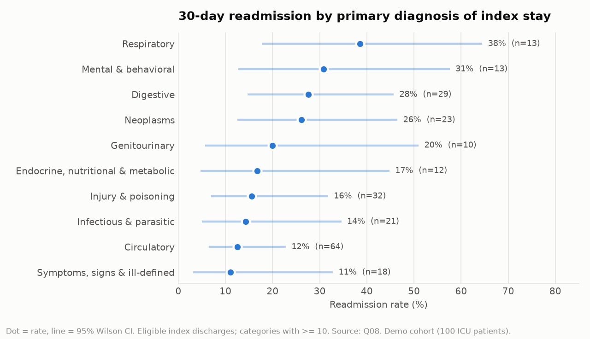
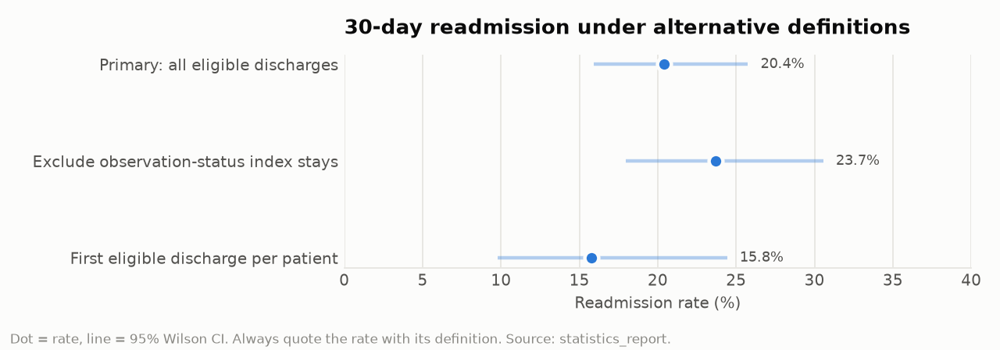
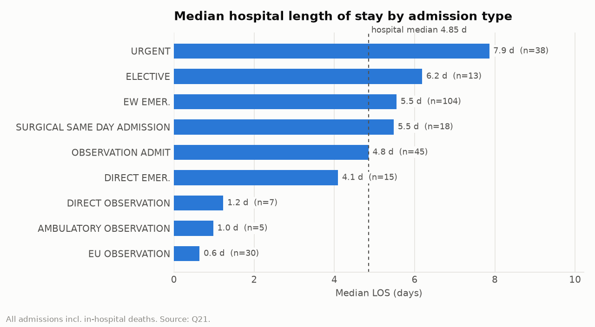
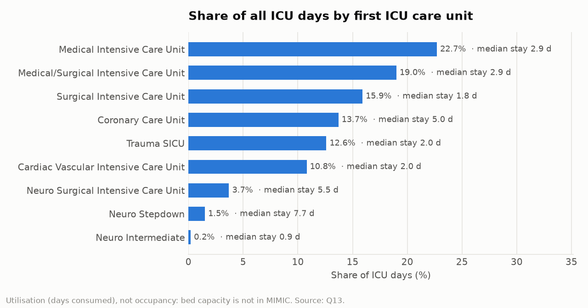
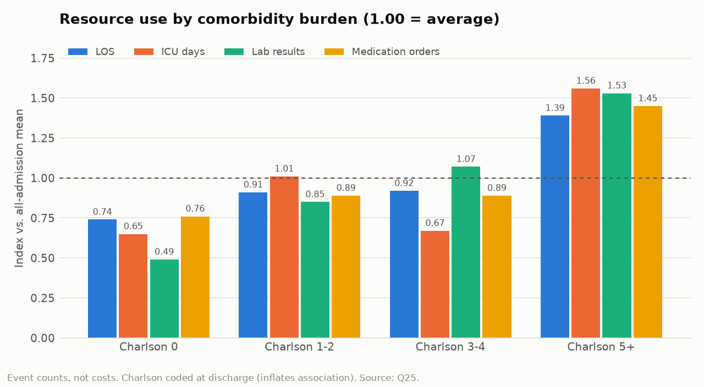

# Hospital Intelligence — Executive Analytics Report

_Generated 2026-11-23 03:40 UTC by `python -m analytics.reporting.executive_report` from the live
warehouse (`mimic-iv-demo-2.2`). Every figure below is queried at generation time;
the supporting SQL is cited by query ID ([catalog](../docs/sql_catalog.md))._

> **Scope and status of these findings.** This analysis runs on the public MIMIC-IV demo:
> **100 patients and 275 admissions**, and every
> patient in it had at least one ICU stay. The findings are **exploratory**. They show what
> the platform measures and which questions deserve full-scale study; they are not validated
> operational conclusions about a hospital population. Recommendations are framed as
> analyses to run on the credentialed full dataset (about 546k admissions in MIMIC-IV v3.1),
> not as changes to make now. No clinical-treatment recommendations are made.

## Executive summary

| KPI | Value | Definition |
|---|---:|---|
| Patients / admissions | 100 / 275 | distinct subject_id / hadm_id |
| Median hospital LOS | 4.85 days (95% CI 4.21–5.71) | discharge − admit, all admissions |
| Admissions with ICU care | 46.5% | ≥1 linked ICU stay (inflated by ICU-only sampling) |
| In-hospital mortality | 5.5% | hospital_expire_flag |
| 30-day all-cause readmission | 20.4% (52/255; 95% CI 15.9–25.8%) | eligible index discharges only; see Q06 |
| 30-day unplanned readmission | 18.8% | next admission not elective / same-day surgical |

**Five things leadership should take away:**

1. **A small group of patients drives most hospital use.** 12 patients with 7+
   admissions account for **43.6% of all admissions** and average
   2.58 30-day readmissions each (Q10). Patient-level
   concentration, not average behaviour, is the lever for readmission work.
2. **The readmission headline depends on definitions.** The same data gives
   **15.8% to 23.7%** depending on defensible choices about observation
   stays and repeat patients. Any readmission KPI must be published with its definition and
   denominator.
3. **Long stays are concentrated in specific admission types.** URGENT admissions have a
   median LOS of 7.86 days (1.62× the hospital
   median), and 18.4% exceed 14 days (Q21).
4. **ICU capacity goes to a minority of long stays.** The 14.3% of ICU stays
   lasting 7+ days consume **45.5% of ICU days** (Q12); the MICU alone
   uses 22.7% of them (Q13).
5. **Comorbidity burden tracks resource use.** Admissions with Charlson ≥5 use
   1.39× average LOS, 1.56× ICU days and 1.53× lab results
   (Q25). These are observable event counts, not costs.

## Major findings

### 1. Readmissions

Of 275 admissions, 20 were excluded from the
denominator (deaths, against-advice discharges, transfers to another acute hospital). Of the
255 eligible discharges, **52 (20.4%)** were followed by
another admission within 30 days. Because frequent patients contribute many correlated
discharges, a patient-cluster bootstrap gives a wider interval
(14.1–26.1%) than the naive Wilson interval.

By principal diagnosis of the index stay, respiratory and mental/behavioural categories rank
highest and circulatory ranks lowest (Q08), but **every interval overlaps**: at this sample
size the ranking generates hypotheses and proves nothing. Returns cluster beyond the 30-day
window: 30.3% of all returns happen within 30 days, but 50.3% happen within 90
(Q09).

### 2. Length of stay

The median stay is 4.85 days and the mean is 6.88. The tail is
long: 10% of stays exceed 14.5 days (Q04).

URGENT admissions (often transfers in from other hospitals) stay longest. A second finding
deserves operational follow-up: encounters registered as **OBSERVATION ADMIT have a median of
4.85 days, and 15.6% last 14+ days**. That is atypical for
observation status and suggests the label persists on encounters that became full inpatient
stays (Q21).

### 3. ICU utilisation and patient flow

The median ICU stay is 2.16 days (Q12). The most common
ICU-related movements are ICU to medical ward and ED to ICU; patients wait a median of
4.3 hours in the ED before ICU transfer (Q14). These are
utilisation measures: without bed-capacity data, **no occupancy percentage is computed or
implied**.

### 4. Clinical workload and case mix

Circulatory disease is the leading principal diagnosis (24.4% of admissions), and
chronic metabolic conditions appear as secondary codes on most stays (Q05). Laboratory
workload follows ICU exposure: Emergency admissions with ICU care generate
32.7% of admission-linked lab results (Q23). Red-cell indices are
the most frequently abnormal high-volume tests, mostly low (Q17); these are measurement
frequencies, not diagnoses.

## Statistical uncertainty

- All rates come with 95% intervals; subgroup intervals are wide because n is small.
- Admissions are clustered within patients (up to 20 per patient), so independence-based
  tests are optimistic. Primary intervals use a patient-level cluster bootstrap
  ([statistics report](statistics_report.md)).
- ICU vs non-ICU LOS shows a large effect (Cliff's δ =
  0.48). Emergency vs elective LOS shows a
  negligible one (δ = -0.04).
- No comparison is adjusted for severity or confounding. Associations are not causal.

## Data limitations

1. **Selected cohort:** every demo patient had an ICU stay, so ICU share, mortality and
   readmission are not hospital-wide rates.
2. **Single hospital:** returns to other hospitals are invisible, so readmission is understated.
3. **No follow-up end date:** late discharges cannot be right-censored.
4. **De-identified dates:** calendar trends, seasonality and day-of-week effects cannot be studied.
5. **No cost, staffing or bed-capacity data:** utilisation proxies are event counts.
6. **Billing codes:** diagnoses reflect documentation practice; Charlson is coded at discharge.

Full list: [docs/limitations.md](../docs/limitations.md).

## Recommendations

Each recommendation follows from a result above and is framed as the next analytical action
for a hospital-operations team using this platform on full data.

1. **Target readmission work at frequent-admission patients.** _Evidence:_ 7+-admission patients
   generate 43.6% of admissions (Q10). _Action:_ build a
   frequent-admitter cohort view and track its readmission rate separately from the
   population rate.
2. **Standardise the readmission KPI definition before reporting it.** _Evidence:_ the rate moves
   from 15.8% to 23.7% across definitions (statistics report §3). _Action:_
   adopt the documented denominator (Q06) as the reporting standard and show sensitivity
   variants next to it.
3. **Review encounter-status labelling for long "observation" stays.** _Evidence:_ OBSERVATION
   ADMIT median LOS 4.85 days with 15.6% over 14 days (Q21).
   _Action:_ join service/status-change data (services table) to see whether these encounters
   converted to inpatient status, which affects both LOS benchmarking and billing classification.
4. **Monitor long ICU stays as a capacity signal.** _Evidence:_ 7+-day stays consume
   45.5% of ICU days (Q12). _Action:_ add a daily "ICU stays beyond 7 days"
   indicator by unit to the operations dashboard; pair it with bed-capacity data (not in MIMIC)
   before computing occupancy.
5. **Extend the readmission window view to 90 days.** _Evidence:_ only 30.3% of returns fall
   within 30 days, versus 50.3% within 90 (Q09). _Action:_ report 30- and 90-day rates
   together to capture early returns the 30-day window misses.

## Platform performance

Selected SQL optimizations measured on this dataset (median of repeated runs; results verified
identical; demo scale, not a full-data projection —
[benchmark report](benchmarks/benchmark_report.md)):

| Case | Technique | Baseline ms | Optimized ms | Speedup | Identical |
|---|---|---:|---:|---:|---|
| C1 | Covering composite index | 11.3 | 0.65 | 17x | yes |
| C2 | Correlated subquery -> LAG() window | 1051.7 | 4.52 | 233x | yes |
| C3 | Pre-aggregation (materialized view) | 56.9 | 0.01 | 5692x | yes |
| C4 | Many correlated scans -> one pass | 13233.2 | 32.16 | 412x | yes |
| C5 | COUNT(DISTINCT) -> two-phase GROUP BY | 119.4 | 49.05 | 2x | yes |
